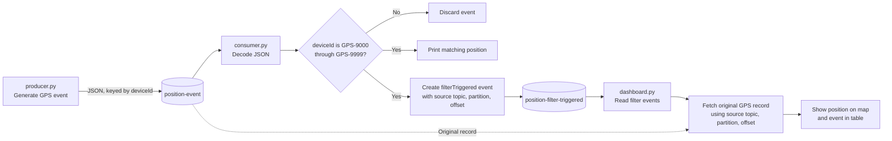

# Kafka GPS event demo

This project demonstrates a small Kafka event pipeline. A Python producer
generates simulated GPS positions, a consumer filters them, and a Streamlit
dashboard displays the filtered events and their positions on a map.

## How it works

1. `producer.py` publishes JSON GPS events to the `position-event` topic. Each
	event has a randomly generated device ID, latitude, longitude, and timestamp.
2. `consumer.py` reads those events and keeps device IDs from `GPS-9000` through
	`GPS-9999`. It writes a `filterTriggered` event for each match to
	`position-filter-triggered`, including the source topic, partition, and
	offset.
3. `dashboard.py` reads the filtered events, fetches the corresponding original
	GPS records, and displays the positions on a map alongside the event table.



## Requirements

- Docker
- Python 3
- Java 17 or newer to run the Kafka command-line tools included in this folder

## Start the demo

Run these commands from the project directory.

1. Start Kafka in the background:

	```sh
	docker run -d --name kafka -p 9092:9092 apache/kafka:4.3.1
	```

2. Create both topics (the Kafka distribution is included in the project):

	```sh
	./kafka_2.13-4.3.1/bin/kafka-topics.sh --create --if-not-exists --topic position-event --bootstrap-server localhost:9092
	./kafka_2.13-4.3.1/bin/kafka-topics.sh --create --if-not-exists --topic position-filter-triggered --bootstrap-server localhost:9092
	```

3. Create and activate a virtual environment, then install the Python
	dependencies:

	```sh
	python3 -m venv .venv
	source .venv/bin/activate
	python -m pip install confluent-kafka pandas streamlit
	```

4. Open three terminals in the project directory, activate the virtual
	environment in each (`source .venv/bin/activate`), and run one command in
	each terminal:

	```sh
	python producer.py
	```

	```sh
	python consumer.py
	```

	```sh
	streamlit run dashboard.py
	```

	Open the URL printed by Streamlit (usually `http://localhost:8501`). The
	producer emits an event every 1–10 seconds; matching events appear in the
	dashboard, which refreshes automatically by default.

Stop the producer and consumer with `Ctrl+C`. Stop the Kafka container with:

```sh
docker stop kafka
```
